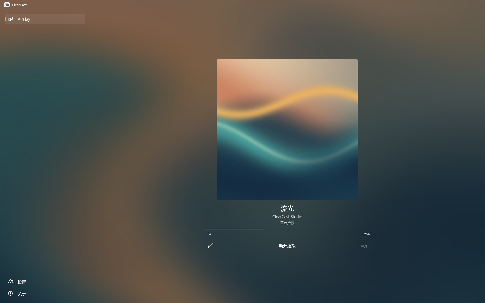
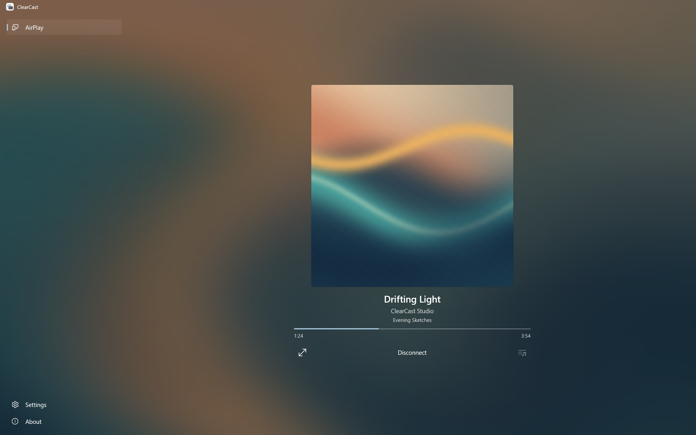

# ClearCast

[中文](#中文) · [English](#english) · [下载 / Download](https://github.com/NCFXZ/ClearCast/releases/latest) · [隐私政策 / Privacy](shared/docs/legal/PRIVACY.md)

## 中文

将 iPhone、iPad 和 Mac 的屏幕、音乐或视频投放到 Windows 电脑。

ClearCast 让你的 Windows 电脑成为 AirPlay 接收端，方便展示屏幕内容，或从兼容的播放器投放音乐和视频。

运行时资源限额、过载处理和安全边界见[稳定性与安全说明](shared/docs/RELIABILITY_SECURITY.md)。



将设备与电脑连接到同一局域网，在设备的「屏幕镜像」或播放器的 AirPlay 选项中选择 ClearCast。两台设备所在的局域网需要允许设备相互访问。

- 接收屏幕画面和声音。
- 音乐投放时显示发送端提供的封面、曲名、歌手、专辑和播放进度；发送端支持控制时可播放、暂停及切换歌曲。由封面纹理生成的流动背景覆盖整个应用，随音乐节奏疏密平滑调速，并随强低频鼓点收放、自然回弹；浅色主题保留更鲜明的封面颜色，切换到「设置」或「关于」后仍继续流动，前景封面、文字和按钮保持稳定。
- 自动从 LRCLIB 查找歌词，支持音乐全屏、逐行高亮和手动浏览；歌词内容及时间轴可能不准确，纯文本歌词会说明不支持滚动。
- 支持全屏显示、向左或向右旋转 90°，以及等比缩放。
- 可在设置中开启视频投放时自动全屏；默认关闭，纯音乐不会自动全屏。
- 使用四位验证码配对，并管理已保存的设备。
- 提供简体中文和英文界面、浅色和深色主题，以及跟随系统的主题选项。

### 使用 AirPlay

1. [下载 Windows x64 安装包](https://github.com/NCFXZ/ClearCast/releases/latest)，安装并打开 ClearCast。使用源码发布目录时，可双击仓库内的 `scripts/Launch-ClearCast.cmd`。
2. 确保设备与此电脑连接到同一网络。Windows 可通过网线接入同一路由器；Windows 防火墙询问时，可为可信的专用网络允许 `ClearCast.exe`。
3. 在设备上打开「屏幕镜像」，或在兼容播放器中打开 AirPlay，选择电脑「AirPlay」页显示的名称，例如 `ClearCast DESKTOP-1234`。新设备请求配对时，在设备上输入电脑显示的四位验证码。
4. 视频画面上的控件可旋转画面或切换全屏；双击画面可切换全屏，按 Esc 可退出全屏。音乐界面显示发送端提供的曲目信息；只有发送端支持时才显示播放控件，否则可继续在发送设备上操作。点击「断开投放」后，应用会继续等待下一次连接。
5. 在「设置 → 播放显示」中选择默认显示大小，或开启「投屏时自动全屏」。自动全屏从下一次视频投放开始生效；当前播放中切换设置不会立即改变窗口。在「设置 → 接收」中选择解码方式；连接期间切换解码方式会保留 AirPlay 连接，画面可能短暂停顿。

可定位的直接视频支持播放/暂停、进度拖动及前后跳转 10 秒。音乐进度在发送端支持并确认定位时可拖动，否则保持只读；空格键切换当前可用的播放/暂停。封面、曲目信息和控制能力取决于发送设备、播放器及内容。音乐与视频的使用方法、协议范围和验证边界见 [AirPlay 媒体说明](shared/docs/AIRPLAY_MEDIA.md)。

设备已连接但尚未播放时，AirPlay 页显示“AirPlay 已连接”；播放结束后仍连接的设备保持该提示，断开后恢复等待。

新设备的验证码有效期为一分钟。验证多次失败后，新配对会短暂暂停，已配对设备仍可连接。验证码请求与后续验证可使用来自同一设备的不同连接。验证码验证通过后，接收端会保存配对记录，以便设备重新连接验证。

「设置」包含常规、接收、播放显示和设备配对。在「设备配对」中展开「已保存的配对」，即可逐台删除设备的配对记录，也可一次删除全部。删除后，该设备下次连接需要重新验证；接收端还会更新配对身份，因此其他已保存设备也可能需要重新验证。当本地没有任何已保存配对时，接收端会更新配对身份，让仍记住旧身份的设备重新显示验证码。

接收器密钥、配对记录、连接日志和显示偏好保存在本地的 `.clearcast-state` 中。仓库启动器将其保存在仓库目录，安装版通常使用 `%LOCALAPPDATA%\ClearCast` 作为数据根目录。发生接收错误时，可点击「复制详情」查看连接记录。数据处理范围见 [隐私政策](shared/docs/legal/PRIVACY.md)。

### 架构

- **桌面界面**由 C#、.NET 10 和 WinUI 3 原生 XAML 实现。标题栏、侧栏和正文共用 Mica 底色，页面以 Windows 设置为参考，使用居中的内容列和原生主题卡片。「AirPlay」页使用本地 SVG 循环动画，按当前显示 DPI 解码；切换页面、窗口最小化或播放媒体时暂停动画。 [微软 Mica 分层指南](https://learn.microsoft.com/en-us/windows/apps/design/style/mica#app-layering-with-mica) · [微软设置页指南](https://learn.microsoft.com/en-us/windows/apps/design/app-settings/guidelines-for-app-settings#layout)
- **接收服务**在 ClearCast 进程内运行。随软件发布的 `receiver\clearcast_receiver.dll` 使用 UxPlay 处理 AirPlay 发现、配对和收流。启动阶段的网卡查询和原生组件加载在后台执行。
- **网络边界**跟随接收网卡；音频依赖当前连接的签名验证，视频跨连接控制依赖已验证设备建立的会话，不能仅凭相同 IP 继承权限。HTTP(S)/HLS 保留公网与局域网来源，连接前检查实际目标地址并拒绝回环地址。详见[稳定性与安全边界](shared/docs/RELIABILITY_SECURITY.md)。
- **播放**由 GStreamer 直接解码来流，自动模式优先尝试 D3D11 硬件解码。镜像画面通过原生子窗口在应用内等比显示。运行时包含独立的 `gst-plugin-scanner.exe`，用于发现随包插件。媒体结束后返回 AirPlay 页，并按实际连接状态显示已连接或等待。
- **音乐背景**预计算 32 张 96×96 的封面扭曲与模糊纹理，由同一相位时钟驱动 33 个图层，任一时刻最多两层可见。原有流动使用 34 个动画通道和一个调速控制器；独立背景缩放、偏移表达式使正常运动共 36 个通道，360ms 阻尼强拍脉冲期间为 37 个，不重启流动相位。速率依据已解码 PCM 的瞬态密度，脉冲依据独立低频瞬态；有界事件历史与代次、序号、年龄校验防止旧拍重播。暂停和过期活动不会保留旧曲目的加速或脉冲状态。浅色纹理增强封面颜色并约束最低亮度，深色处理保持原样。设计、来源及验证边界见[音乐背景说明](shared/docs/MUSIC_BACKGROUND.md)。

### 工作空间结构

```text
ClearCast.slnx           解决方案入口
AGENTS.md               长期编码、架构、安全与协作规则
PROGRESS.md             当前基线、任务范围、进展与待办
src/ClearCast/          WinUI 项目、界面、服务、本地化与素材
src/native/             原生接收器代码、CMake 配置与上游补丁
tests/                  托管、原生、UI、媒体与打包测试
scripts/                启动、原生构建与打包脚本
packaging/              安装包与商店包模板、商店元数据
shared/docs/            测试与打包说明、法律文档和发行说明
.runtime/               本地构建工具、依赖、产物和测试结果（不提交）
```

开发时可打开根目录的 `ClearCast.slnx`。下文命令均从仓库根目录执行；托管状态测试使用 `tests/managed/ManagedStateTests.csproj`。

### 构建界面

ClearCast 支持 Windows x64。除安装包外，也可从源码发布为免安装文件夹；输出内包含 .NET、Windows App SDK 和接收组件。已有 `.runtime\app\ClearCast.exe` 时可直接使用。

从源码构建时，先按下一节准备接收组件，再在仓库根目录用 `global.json` 指定的 .NET 10.0.404 SDK（或同功能带更新补丁）执行以下命令。 [Windows App SDK 自包含发布](https://learn.microsoft.com/en-us/windows/apps/package-and-deploy/unpackage-winui-app)

```powershell
dotnet publish .\src\ClearCast\ClearCast.csproj -c Release -r win-x64 -o .\.runtime\app
```

如果 SDK 已放在项目内的 `.runtime\dotnet`，将命令中的 `dotnet` 换为 `.\.runtime\dotnet\dotnet.exe`。发布目录内的文件需要保留在一起，包括完整的 `receiver` 目录及 `Assets\MirroringAnimation`。安装包、商店包与对应源码的制作流程见 [打包说明](shared/docs/packaging.md)。

### 准备 Windows 接收运行时

接收组件采用带内置 mDNS 的 UxPlay 1.74 实验版源码。构建脚本生成接收 DLL，并将所需的 GStreamer 插件、扫描器和依赖收集到 `.runtime\receiver`。发布时保留 `receiver` 目录结构。 [上游提交](https://github.com/FDH2/UxPlay/commit/d4b7373cb6107b2d8d6c5838991c19d39e2b96ae)

从 [MSYS2 官网](https://www.msys2.org/) 安装 MSYS2，在 **MSYS2 UCRT64** 终端更新。若更新要求关闭终端，重新打开 UCRT64 后再执行一次 `pacman -Syu`。然后安装构建依赖：

```bash
pacman -Syu
```

```bash
pacman -S --needed git diffutils \
  mingw-w64-ucrt-x86_64-{gcc,cmake,meson,ninja,pkgconf,openssl,libplist,gstreamer} \
  mingw-w64-ucrt-x86_64-gst-{plugins-base,plugins-good,plugins-bad,libav}
```

使用 PowerShell 7 构建，并确保 `git` 在 PATH 中。在仓库根目录下载固定版本的源码。若使用项目内的 `.runtime\msys64\ucrt64`，可省略 `-Ucrt64Directory`。

```powershell
New-Item -ItemType Directory -Force .runtime
Invoke-WebRequest 'https://codeload.github.com/FDH2/UxPlay/tar.gz/d4b7373cb6107b2d8d6c5838991c19d39e2b96ae' -OutFile .runtime\uxplay-d4b7373.tar.gz
Invoke-WebRequest 'https://github.com/libimobiledevice/libplist/releases/download/2.8.0/libplist-2.8.0.tar.bz2' -OutFile .runtime\libplist-2.8.0.tar.bz2
pwsh -File .\scripts\native\Build-OpenSslSecurity.ps1 -Ucrt64Directory C:\msys64\ucrt64 -RuntimeDirectory .runtime\openssl-security
pwsh -File .\scripts\native\Build-LibplistSecurity.ps1 -Ucrt64Directory C:\msys64\ucrt64 -DiffDirectory C:\msys64\usr\bin
pwsh -File .\scripts\native\Build-GStreamerSecurity.ps1 -Ucrt64Directory C:\msys64\ucrt64
pwsh -File .\scripts\native\Build-GStreamerHttpSecurity.ps1 -Ucrt64Directory C:\msys64\ucrt64
pwsh -File .\scripts\native\Build-Receiver.ps1 -Ucrt64Directory C:\msys64\ucrt64
```

安全组件构建脚本验证固定官方源码的 SHA-256，独立构建 libplist 2.8.0、OpenSSL 3.5.9 LTS，以及 GStreamer 1.28.9 的 codecparsers、videoparsersbad 和带受控目标地址补丁的 HTTP 源 libgstsoup。其余组件使用 MSYS2 运行时。构建工具和安全组件使用独立目录，不覆盖 MSYS2 安装；接收器构建会验证组件、头文件、导入库及源码补丁的清单与哈希，缺失或不匹配时停止。HTTP 组件的 `gstreamer-http-security-manifest.json` 和 `LICENSE-GStreamerHttpSecurity.txt` 必须随 receiver 发布。构建完成后执行上一节的发布命令。

### 清晰度与真机验收

接收端直接解码并显示视频。开始接收时，根据 Windows 报告的网卡链路速率选择初始画质。自动或硬件解码时，有线速率达到 100 Mb/s 或 Wi-Fi 协商速率达到 400 Mb/s 会请求 4K HEVC；低于 50 Mb/s 请求 720p，其余情况请求 1080p。三档均请求每秒 30 帧；软件解码最高请求 1080p。链路速率是本机到网络的连接速率，实际画质与帧率由设备和传输条件决定。

非全屏视频保留完整比例和圆角，空余区域由覆盖整个应用的柔和动态背景填充，镜头变化平滑过渡。控制栏放在画面下方，支持的点播视频提供进度、暂停和前后 10 秒；空格键触发当前可用的播放/暂停。镜像与直播只显示断开、旋转和全屏。

在 iPhone、iPad 和 Mac 上分别验证默认画质、横竖屏、全屏和断开重连。比较 Wi-Fi 和有线网络时，可在「AirPlay」页查看解码尺寸和播放帧率。

1. 镜像有小字号文字和细线的网页或 PDF，调整窗口大小和最大化，检查可读性、比例和裁切。切换横竖屏，再切到「设置」并返回「屏幕镜像」，确认画面继续播放。
2. 播放一段持续有运动的本地非 DRM 视频，观察卡顿、花屏和音画同步。
3. 从设备上停止镜像，确认应用回到等待状态并可重新连接。也可点击 ClearCast 的「断开屏幕镜像」，再从设备上重新连接。

这些是真机验收步骤，不代表所有设备、网络和驱动组合均已验证。自动检查的运行方法和范围见 [托管状态与 UI 测试](shared/docs/testing.md) 和 [原生接收器测试](shared/docs/testing-native.md)。

### 排查

- **AirPlay 列表里没有 ClearCast。** 检查两台设备是否位于同一局域网、访客网络是否隔离设备，以及 Windows 防火墙是否允许 `ClearCast.exe`。AirPlay 发现使用 UDP 5353，接收端使用 TCP 和 UDP 47000–47002。
- **设备提示输入密码。** 在设备上输入电脑当前显示的四位「AirPlay 验证码」。设备探测旧配对身份不等于本次验证码验证失败；若实际验证失败或验证码失效，请重新选择 ClearCast 后使用新验证码。
- **设备提示无法连接，电脑没有验证码。** 接收器会在 `.clearcast-state\receiver.log` 记录连接阶段；仅有 `ready` 而没有设备连接记录时，检查设备是否允许互访，以及当前启动的 `ClearCast.exe` 是否被防火墙允许。校园或访客网络可能允许发现但隔离连接。「复制详情」会附带最近的连接记录；日志不包含验证码、密钥或镜像内容。
- **有声音但画面黑屏。** 先镜像设备的设置界面或本地照片。若只有受保护的视频黑屏，换用普通本地视频验证。若一般内容也黑屏，在「设置 → 接收」中试用自动或软件解码。
- **画面尺寸偏低或卡顿。** 查看解码尺寸和播放帧率，检查设备是否支持 HEVC，以及两台设备的网络连接。改善连接后重新开始接收可更新画质请求。

### 开源许可证

ClearCast 的原创源码和项目素材采用 GNU 通用公共许可证第 3 版或更高版本（`GPL-3.0-or-later`）。接收组件基于修改后的 UxPlay，第三方组件和图标保留各自的许可。详见 [LICENSE](LICENSE) 和 [第三方声明](shared/docs/legal/THIRD-PARTY-NOTICES.md)。

## English

Mirror your screen, or play AirPlay music and video on a Windows PC.

ClearCast turns your Windows PC into an AirPlay receiver for screen sharing and media from compatible players.



Music supports full screen and automatic lyrics from LRCLIB. Timed lyrics highlight line by line; plain lyrics can be browsed manually and show an unsupported-scrolling notice. Lyrics and timing may be inaccurate.

Connect your device and PC to the same local network, then select ClearCast in Screen Mirroring or your player’s AirPlay menu. The network must allow the two devices to communicate with each other.

- Receive screen video and audio.
- Show the artwork, title, artist, album, and playback progress supplied with music; play, pause, and change tracks when the sending device supports those controls. An artwork-textured background spans the whole app, adjusts its pace smoothly to rhythmic density, adds a damped rebound for strong low-frequency beats, and keeps flowing on Settings and About. The light theme retains richer artwork colors, while foreground artwork, text, and controls stay still.
- Use full-screen display, rotate the picture 90° in either direction, and scale it while preserving its aspect ratio.
- Optionally enter full screen when a new video session starts. This is off by default and does not apply to audio-only sessions.
- Pair using a four-digit code and manage saved devices.
- Choose a Simplified Chinese or English interface and a light, dark, or system-controlled theme.

### Use AirPlay

1. [Download the Windows x64 installer](https://github.com/NCFXZ/ClearCast/releases/latest), install ClearCast, and open it. For a source checkout with a published app, run `scripts/Launch-ClearCast.cmd` in the repository.
2. Make sure your device and this PC are connected to the same network. The PC can use Ethernet to the same router. If Windows Firewall asks, allow `ClearCast.exe` on a trusted private network.
3. Open Screen Mirroring or AirPlay in a compatible player and select the name shown on the PC’s **AirPlay** page, such as `ClearCast DESKTOP-1234`. For a new pairing, enter the four-digit code shown on the PC.
4. Use the video controls to rotate the picture or enter full screen. Double-click the picture to toggle full screen, or press Esc to leave it. The music view shows the details supplied by the sender; playback controls appear only when the sender provides them; otherwise, use the sending device. Select **Disconnect** to end the session and wait for another connection.
5. Choose a default picture size or enable **Automatically enter full screen** in **Settings → Playback**. The option applies to the next video session; changing it during playback does not immediately change the window. Choose a decoder in **Settings → Receiving**. Changing the decoder during a session keeps the AirPlay connection; the picture may pause briefly.

Seekable direct video supports play/pause, progress dragging, and 10-second skips. Music seeking is available when the sender supports and confirms it; otherwise progress remains read-only. Space toggles available playback controls. Artwork, metadata, and controls depend on the sending device, player, and content. See the [AirPlay media guide](shared/docs/AIRPLAY_MEDIA.md) for usage, protocol scope, and validation limits.

The AirPlay page shows **AirPlay connected** when a device is connected without playing media. It keeps this status after playback ends while the connection remains active, and returns to waiting when the device disconnects.

A new device's code is valid for one minute. After repeated failures, new pairing attempts pause briefly; saved devices can still connect. The request for a code and its subsequent verification can use different connections from the same device. Successful code verification saves the pairing so that the device can verify again on a new connection.

Settings contains General, Receiving, Playback, and Device pairing. Expand **Saved pairings** under **Device pairing** to remove one device or all saved devices. A removed device must verify again on its next connection. Removing pairings also renews the receiver identity, so other saved devices may need to verify again. If no saved pairings remain, the receiver renews its identity so a device that remembers an older identity can request a new code.

The receiver key, saved pairings, connection log, and preferences are stored locally in `.clearcast-state`. The repository launcher uses the repository as the data root; an installed app normally uses `%LOCALAPPDATA%\ClearCast`. For a reception error, choose **Copy details** to inspect recent connection records. See the [privacy policy](shared/docs/legal/PRIVACY.md) for how data is handled.

### Architecture

- **Desktop UI:** C#, .NET 10, and native WinUI 3 XAML. The title bar, sidebar, and content share a Mica backdrop. Centered content and themed cards follow the Windows Settings layout. The AirPlay page uses a local SVG loop rendered for the current display DPI; it pauses on other pages, when minimized, and while media is playing. [Microsoft Mica layering guidance](https://learn.microsoft.com/en-us/windows/apps/design/style/mica#app-layering-with-mica) · [Microsoft settings layout guidance](https://learn.microsoft.com/en-us/windows/apps/design/app-settings/guidelines-for-app-settings#layout)
- **Receiver:** `receiver\clearcast_receiver.dll` runs in the ClearCast process and uses UxPlay for AirPlay discovery, pairing, and incoming streams. Adapter discovery and native component loading run in the background during startup.
- **Network boundary:** Receiving follows the selected adapter. Audio requires the current transport's signature verification; video handoffs use a session issued to a verified device, never its IP address alone. Public and LAN HTTP(S)/HLS sources remain supported, with resolved destinations checked before connecting and loopback addresses rejected. See the [stability and security boundaries](shared/docs/RELIABILITY_SECURITY.md).
- **Playback:** GStreamer decodes incoming streams directly. Automatic mode first tries D3D11 hardware decoding. A native child window displays video inside the app while preserving its aspect ratio. The runtime includes `gst-plugin-scanner.exe` for discovering the bundled plugins. When media ends, the AirPlay page shows the current connected or waiting state.
- **Music background:** 32 precomputed 96×96 warped and blurred artwork textures share one phase clock across 33 layers, with at most two visible at a time. The existing flow uses 34 animation channels and one rate controller; independent background scale and offset expressions bring normal motion to 36 channels and a 360 ms damped beat impulse to 37, without restarting the flow phase. Decoded PCM transient density controls the pace, while a separate low-frequency detector supplies impulses. Bounded event history, epochs, sequences, and ages prevent replaying old beats. Paused or stale activity does not retain the previous track's speed or pulse. Light textures use richer artwork colors with a minimum-brightness guard; dark-theme processing is unchanged. See the [background design and validation boundaries](shared/docs/MUSIC_BACKGROUND.md).

### Workspace layout

```text
ClearCast.slnx           Solution entry point
AGENTS.md               Long-term coding, architecture, security, and collaboration rules
PROGRESS.md             Current baseline, scope, progress, and pending work
src/ClearCast/          WinUI project, views, services, localization, and assets
src/native/             Native receiver code, CMake configuration, and upstream patches
tests/                  Managed, native, UI, media, and packaging tests
scripts/                Launcher, native build, and packaging scripts
packaging/              Installer and Store templates and Store metadata
shared/docs/            Testing and packaging guides, legal documents, and release notes
.runtime/               Local tools, dependencies, outputs, and test results (untracked)
```

Open the root `ClearCast.slnx` for development. Run the commands below from the repository root; managed state tests use `tests/managed/ManagedStateTests.csproj`.

### Build the app

ClearCast supports Windows x64. Alongside the installer, a source build can produce a portable folder containing .NET, Windows App SDK, and the receiver runtime. An existing `.runtime\app\ClearCast.exe` can be launched directly.

First prepare the receiver runtime below, then publish from the repository root with .NET SDK 10.0.404 or a newer patch in the same feature band, as specified by `global.json`. [Windows App SDK self-contained deployment](https://learn.microsoft.com/en-us/windows/apps/package-and-deploy/unpackage-winui-app)

```powershell
dotnet publish .\src\ClearCast\ClearCast.csproj -c Release -r win-x64 -o .\.runtime\app
```

If the SDK is installed under `.runtime\dotnet`, replace `dotnet` with `.\.runtime\dotnet\dotnet.exe`. Keep all published files together, including the complete `receiver` and `Assets\MirroringAnimation` directories. See the [packaging instructions](shared/docs/packaging.md) for installers, Store packages, and corresponding source archives.

### Prepare the Windows receiver runtime

The receiver uses a pinned UxPlay 1.74 development source revision with built-in mDNS. Its build script produces the receiver DLL and collects the required GStreamer plugins, scanner, and dependencies into `.runtime\receiver`. Preserve the `receiver` directory structure when distributing the app. [Pinned upstream commit](https://github.com/FDH2/UxPlay/commit/d4b7373cb6107b2d8d6c5838991c19d39e2b96ae)

Install MSYS2 from its [official site](https://www.msys2.org/) and update it in an **MSYS2 UCRT64** terminal. If the update asks you to close the terminal, reopen UCRT64 and run `pacman -Syu` again. Then install the build dependencies:

```bash
pacman -Syu
```

```bash
pacman -S --needed git diffutils \
  mingw-w64-ucrt-x86_64-{gcc,cmake,meson,ninja,pkgconf,openssl,libplist,gstreamer} \
  mingw-w64-ucrt-x86_64-gst-{plugins-base,plugins-good,plugins-bad,libav}
```

Build with PowerShell 7 and `git` on PATH. Download the pinned source archive from the repository root. Omit `-Ucrt64Directory` if using the repository-local `.runtime\msys64\ucrt64` toolchain.

```powershell
New-Item -ItemType Directory -Force .runtime
Invoke-WebRequest 'https://codeload.github.com/FDH2/UxPlay/tar.gz/d4b7373cb6107b2d8d6c5838991c19d39e2b96ae' -OutFile .runtime\uxplay-d4b7373.tar.gz
Invoke-WebRequest 'https://github.com/libimobiledevice/libplist/releases/download/2.8.0/libplist-2.8.0.tar.bz2' -OutFile .runtime\libplist-2.8.0.tar.bz2
pwsh -File .\scripts\native\Build-OpenSslSecurity.ps1 -Ucrt64Directory C:\msys64\ucrt64 -RuntimeDirectory .runtime\openssl-security
pwsh -File .\scripts\native\Build-LibplistSecurity.ps1 -Ucrt64Directory C:\msys64\ucrt64 -DiffDirectory C:\msys64\usr\bin
pwsh -File .\scripts\native\Build-GStreamerSecurity.ps1 -Ucrt64Directory C:\msys64\ucrt64
pwsh -File .\scripts\native\Build-GStreamerHttpSecurity.ps1 -Ucrt64Directory C:\msys64\ucrt64
pwsh -File .\scripts\native\Build-Receiver.ps1 -Ucrt64Directory C:\msys64\ucrt64
```

The security-component scripts verify pinned official source SHA-256 values and independently build libplist 2.8.0, OpenSSL 3.5.9 LTS, and GStreamer 1.28.9 codecparsers, videoparsersbad and libgstsoup with the controlled destination-address patch. The remaining components come from the MSYS2 runtime. Build tools and security components use separate directories without overwriting the MSYS2 installation. The receiver build validates binaries, headers, import libraries and source patches against their manifests and stops on missing or mismatched files. Ship `gstreamer-http-security-manifest.json` and `LICENSE-GStreamerHttpSecurity.txt` with the receiver. Then run the app publish command above.

### Picture quality and device acceptance checks

ClearCast decodes and displays incoming video directly. At startup, it chooses an initial quality request from the adapter link speed reported by Windows. Automatic and hardware decoding request 4K HEVC for Ethernet links of at least 100 Mb/s or negotiated Wi-Fi links of at least 400 Mb/s. Links below 50 Mb/s request 720p; other links request 1080p. All three modes request 30 frames per second. Software decoding requests at most 1080p. Link speed describes the local network connection; the device and transmission conditions determine the actual picture quality and frame rate.

Windowed video keeps its full aspect ratio and rounded corners, with a soft animated background filling the whole app and smoothing scene changes. The controls sit below the video. Seekable video offers progress, pause, and ten-second skip buttons; Space toggles supported playback. Mirroring and live video show only disconnect, rotation, and full screen.

Check default quality, orientation changes, full screen, and reconnection separately on iPhone, iPad, and Mac. Use the decoded dimensions and playback frame rate on the AirPlay page when comparing Wi-Fi and Ethernet.

1. Mirror a webpage or PDF with small text and fine lines. Resize and maximize the window to check readability, aspect ratio, and cropping. Change orientation, visit Settings, and return to Screen mirroring to confirm playback continues.
2. Play a local, non-DRM video with continuous motion and check for stutter, corruption, and audio/video synchronization.
3. Stop mirroring on the device and confirm the app returns to waiting and accepts another connection. Also use ClearCast's **Disconnect** action and reconnect from the device.

These are device acceptance procedures, not a claim that every device, network, and driver combination has been validated. See [managed state and UI tests](shared/docs/testing.md) and [native receiver tests](shared/docs/testing-native.md) for automated checks and their scope.

### Troubleshooting

- **ClearCast is missing from the AirPlay list.** Check that both devices use the same local network, that the network permits communication between devices, and that Windows Firewall allows `ClearCast.exe`. AirPlay discovery uses UDP 5353; the receiver uses TCP and UDP 47000–47002.
- **The device asks for a password.** Enter the PC's current four-digit **AirPlay pairing code** on the device. A probe using an older saved identity does not itself mean the current code failed. After a real verification failure or an expired code, select ClearCast again and use the new code.
- **The device cannot connect and no code appears on the PC.** `.clearcast-state\receiver.log` records connection stages. If it contains only `ready` and no device connection, check communication between devices and the firewall permission for the running `ClearCast.exe`. Campus or guest networks can permit discovery while blocking connections. **Copy details** includes recent connection records without pairing codes, keys, or mirrored content.
- **Audio plays but the picture is black.** Mirror the device's Settings app or a local photo first. If only protected video is black, test with an ordinary local video. If other content is also black, try Automatic or Software decoding in **Settings → Receiving**.
- **The picture is small or stutters.** Inspect decoded dimensions and playback frame rate, the device's HEVC support, and both devices' network connections. Start a new session after improving the connection to refresh the quality request.

### License

ClearCast's original source and project assets use the GNU General Public License version 3 or later (`GPL-3.0-or-later`). The receiver is based on modified UxPlay. Third-party components and icons retain their own terms. See [LICENSE](LICENSE) and the [third-party notices](shared/docs/legal/THIRD-PARTY-NOTICES.md).
